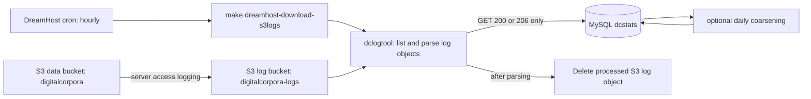
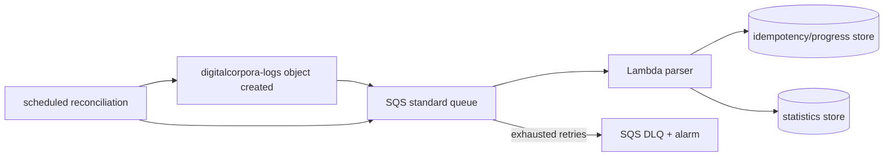

# Theory of Operation

This document describes the implementation in this repository as of 2026-08-06.
It intentionally distinguishes the production path from planned or historical
paths. `Design.md` is a project roadmap, not an operational description.

## Purpose and boundaries

The system records access to downloadable DigitalCorpora objects and maintains
an inventory of objects and their SHA-256/SHA3-256 hashes. Its current durable
store is the `dcstats` MySQL database at `mysql.digitalcorpora.org` (the same
host is also reachable as `mysql.simson.net`).

It has two independent jobs:

1. ingest S3 server-access-log objects from `digitalcorpora-logs` into MySQL;
2. inventory and hash objects in the `digitalcorpora` data bucket on demand.

The currently installed DreamHost cron invokes only the first job. It does not
run the daily coarsening job or the object-hashing job.

## Current production flow



### Deployment and invocation

The production account runs, hourly, from `$HOME/digitalcorpora-stats`:

```text
timeout -k 5s 30m make dreamhost-download-s3logs
```

That Make target sources `$HOME/dbwriter.bash` and invokes
`python/dclogtool.py --s3_logs_download_ingest_and_save --env --prod
--loglevel WARNING -j10 --ignore_keys ignore.txt`. The process therefore needs
AWS read/delete access to `digitalcorpora-logs` and MySQL writer credentials.
`--aws` is an alternative credential path: it reads the
`digitalcorpora/dbwriter` Secrets Manager secret in `us-west-2`.

The five-second kill grace after the thirty-minute timeout means that a
long run can be terminated while processing. A process-local lock prevents
normal concurrent command invocations, but does not itself provide durable
per-log-object progress.

### Log ingestion

`s3_logs_download_ingest_and_save` lists every object in
`digitalcorpora-logs`, feeds object keys to ten worker threads, and each worker
does the following:

1. fetches the log object and parses it line by line with `weblog.S3Log`;
2. ignores keys listed in `ignore.txt`;
3. accepts only `REST.GET.OBJECT`, `REST.COPY.PART_GET`, or
   `WEBSITE.GET.OBJECT` records with HTTP 200 or 206 as downloads;
4. inserts the object key into `downloadable` and the user agent into
   `user_agents` if each is new, then inserts a `downloads` row;
5. appends accepted source lines to `$HOME/s3logs/s3logs.<year>.log`; and
6. deletes the source log object from `digitalcorpora-logs` after its complete
   object has been read.

Uploads, deletions, blocked requests, miscellaneous operations, invalid
responses, and unknown operations are counted/logged but not represented as a
download. The source log object is deleted even if it contains no accepted
download lines.

The database has no source-log-object or source-record id. It uses best-effort
in-process sets to avoid repeated `downloadable` and `user_agents` insert
attempts, but each accepted log line inserts a new `downloads` row. Thus a
retry after a partial failure can duplicate download records, while a failure
or termination before deletion leaves the source object available for retry.

### Schema and coarsening

`python/schema.sql` is a snapshot from 2023-01-15 of the MySQL schema:

* `downloadable` — one row per S3 key, with object metadata, hashes, and a
  `present` marker;
* `user_agents` — normalized user-agent strings; and
* `downloads` — individual accepted download records, joined to the other two
  tables by numeric foreign keys.

`--download_summarize` coarsens each selected calendar day in place. It inserts
one row per `(downloadable object, remote IP, user agent, day)`, with summed
bytes and `summary=1`, then deletes that day's `summary=0` rows. The top-level
`summarize` target currently hard-codes 2025 and is not in the supplied cron.
There is no yearly aggregation implementation in this checkout; `NOTES.txt`
contains a manual yearly-database rollover recipe, not an executable job.

### Inventory and hashing

`--hash_s3prefix` is a separate, manually invoked scan. It lists the specified
prefix in `digitalcorpora`, compares each ETag with MySQL rows that already
have both hashes, streams changed/new objects to compute SHA-256 and SHA3-256,
then updates `downloadable`. It is not triggered by the current cron.

`python/dcindex.py` is a small experimental DynamoDB utility for a
`DigitalCorporaObjects` table. It is not integrated with `dclogtool`, the
schema, or deployment, and is not the current inventory authority.

## Recommended event-driven replacement

Use an S3 notification for objects written to **`digitalcorpora-logs`**, not
only objects written to `digitalcorpora`: these log objects are the inputs that
represent downloads. A data-bucket object-created notification is appropriate
as a separate path for inventory/hash updates.

The robust ingestion topology is:



S3 event delivery is at-least-once and can be duplicated or delayed. The
handler must therefore be idempotent; deleting log objects is neither needed
nor an adequate acknowledgement protocol. Use an immutable event identity such
as `(bucket, key, version-id)` when bucket versioning is enabled, otherwise
`(bucket, key, ETag)`, with an explicit state machine (`received`, `processing`,
`complete`, `failed`). Each derived download must also have a deterministic
source identity, for example log-object identity plus record number or a hash
of the raw source line, so a partial retry cannot double-count it.

SQS absorbs bursts, supports a DLQ and alarms, and lets Lambda retry without
losing events. A scheduled reconciliation should list log objects and enqueue
anything not marked complete; it is the recovery path for notification
misconfiguration, historical backfill, and operational mistakes. The approved
policy is to delete a log object after durable completion rather than retain a
raw-log archive; a short-lived idempotency record and summarized operational
data provide the recovery and reporting state.

The Lambda must process a bounded log object within its timeout/memory limits.
For larger files, checkpoint progress durably or split the work; do not use a
single, non-transactional batch as the completion signal. Instrument backlog
age, handler errors, DLQ depth, parser rejects, duplicate suppression, and
end-to-end ingest latency.

## Storage assessment

Do not perform a wholesale MySQL-to-DynamoDB migration before defining the
read/reporting workload. The two workloads should be separated:

| Data | Recommended near-term authority | Reason |
| --- | --- | --- |
| Object inventory and hashes | DynamoDB is reasonable | Keyed by S3 object key; event-driven upserts and conditional idempotency fit naturally. |
| Log-object idempotency/progress | DynamoDB | Conditional writes and TTL fit retry/dedup state. |
| Raw accepted download events | Keep in MySQL initially, or archive in S3 for Athena | Current model is relational and reporting-oriented; DynamoDB would require deliberate access patterns and multiple indexes. |
| Daily/yearly public statistics | Materialized aggregate table/store | Queries should read precomputed aggregates rather than raw events. |

Keeping MySQL for events permits an incremental migration and preserves the
existing relational queries and WordPress-facing use. However, Lambda-to-
DreamHost MySQL is a fragile direct dependency: it requires a publicly
reachable database or network bridging, connection control during concurrency,
credential rotation, and a stable source egress policy. If serverless,
AWS-native operation is the primary objective, use DynamoDB for idempotency and
aggregates and retain raw logs in S3; provide reporting through Athena or an
export/materialization process. Do not model every existing MySQL row in one
DynamoDB table without first documenting exact query patterns, retention, and
privacy requirements.

## Operational invariants

* S3 delivery is not exactly once; the stored statistic must be exactly once
  with respect to a defined source identity.
* A source log must be retained until durable completion is recorded; a
  short-lived completion/idempotency record must remain recoverable for
  reconciliation after source deletion.
* Coarsening must be transactional/idempotent and must not race with late log
  arrival for the same calendar day.
* Credentials must be external to the repository and granted least privilege.
* The deployed code, infrastructure definition, and recovery procedure must be
  versioned together and tested with S3/queue/database local integrations.

## Observed implementation debt

The following findings are based on the checkout, not on a production run:

* The current queue workers do not propagate exceptions to their advertised
  backchannel. An exception before `q.task_done()` leaves the parent blocked in
  `q.join()` until the external cron timeout kills it.
* A successful ingestion deletes its only S3 input immediately. This defeats
  replay/audit unless the local append-only file is healthy, and it has no
  durable completion record.
* `s3_get_object(url=...)` references an undefined `Prefix` name. The active
  log path uses explicit bucket/key arguments, so this dormant URL path fails
  when exercised.
* `s3_logs_info` is defined twice; the second definition shadows the correct
  version and calls `s3_get_objects` with invalid arguments. `--gc` instead
  references undefined `D3_DATA_BUCKET`; its empty-set SQL paths are also
  unsafe. These maintenance commands require repair before use.
* The supplied schema snapshot is dated 2023, while the code and notes contain
  later operational assumptions. There is no migration history or reproducible
  schema-bootstrap path for a clean environment.
* Tests do not isolate S3 or MySQL. The S3 test contacts the real
  `digitalcorpora` bucket and currently fails without AWS credentials; MySQL
  tests are skipped unless externally supplied credentials exist. Use MinIO and
  a local MySQL-compatible service for logic/integration tests, and make the
  default `make check` select a managed Python environment.
* The repository has no Lambda, S3 notification, SQS/DLQ, IAM policy, or
  infrastructure-as-code definition, so the AWS configuration note is not a
  deployable event-driven system.
